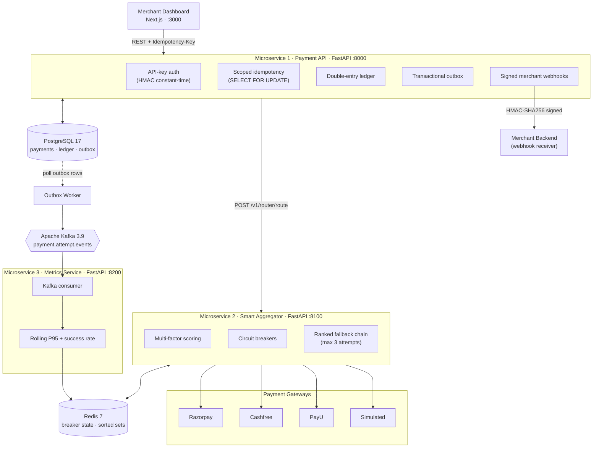
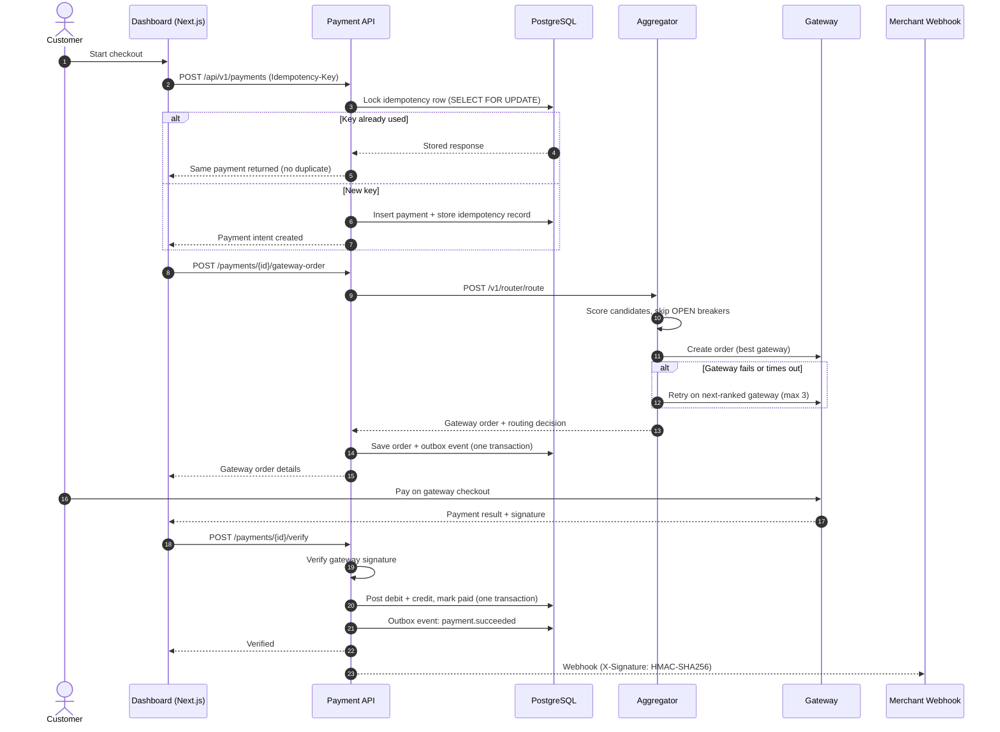
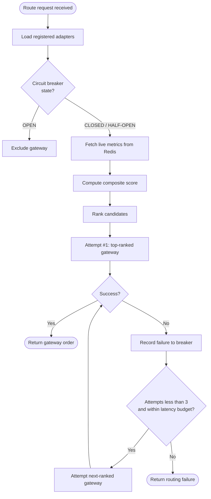
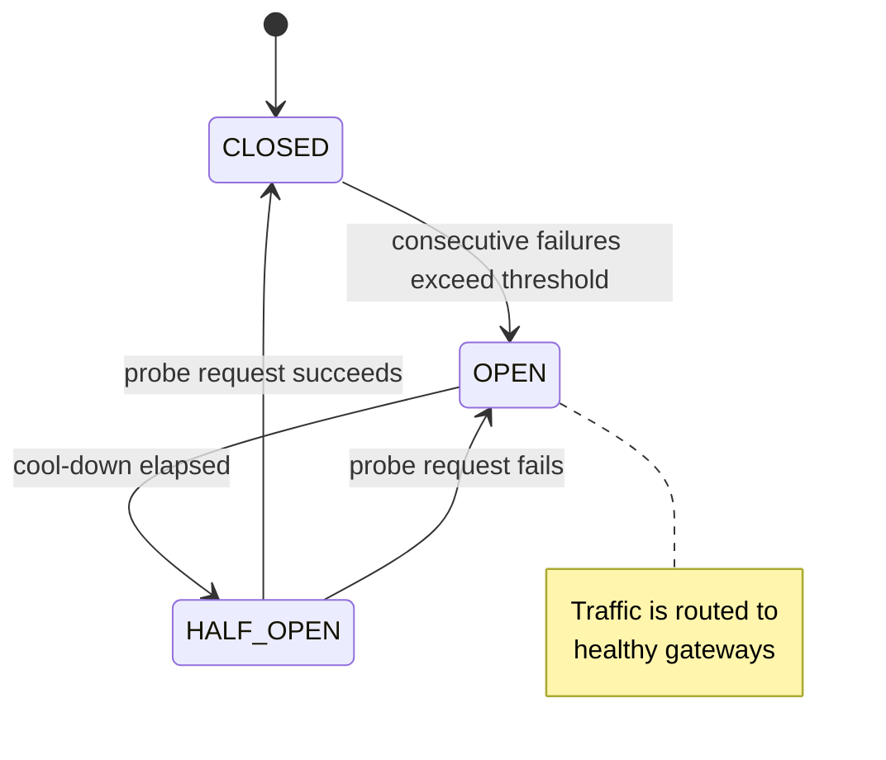
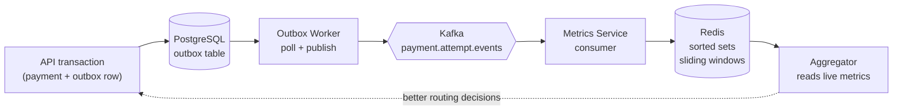
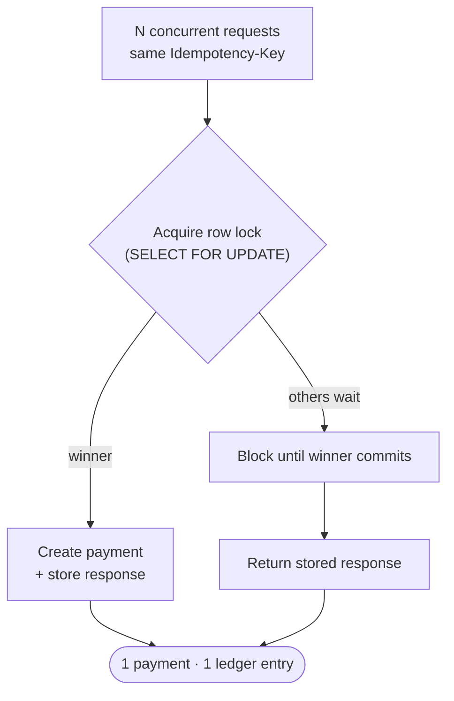
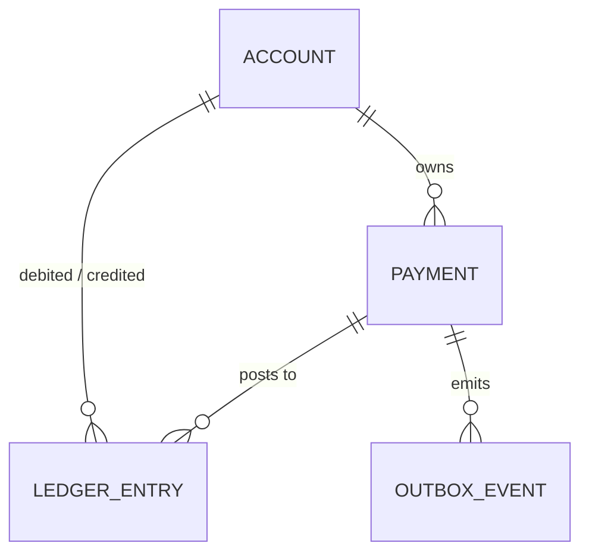

# LedgerCore — Distributed Payment Platform

[](https://fastapi.tiangolo.com)
[](https://nextjs.org)
[](https://www.postgresql.org)
[](https://redis.io)
[](https://kafka.apache.org)
[](https://www.docker.com)
[](#testing--verification)
[](#license)

**LedgerCore** is a high-availability, multi-tenant payment processing platform built for mission-critical financial transactions: **no double-charging**, **intelligent real-time gateway routing**, **immutable double-entry accounting**, and **automatic failover**.

Instead of binding to a single payment gateway, LedgerCore acts as an intelligent intermediary that routes each payment across **Razorpay**, **Cashfree**, **PayU**, and simulated fallback gateways, based on live performance metrics.

---

## Table of Contents

1. [Highlights](#highlights)
2. [System Architecture](#system-architecture)
3. [End-to-End Payment Flow](#end-to-end-payment-flow)
4. [Intelligent Routing & Failover](#intelligent-routing--failover)
5. [Circuit Breaker](#circuit-breaker)
6. [Transactional Outbox & Telemetry Pipeline](#transactional-outbox--telemetry-pipeline)
7. [Idempotency & Concurrency Control](#idempotency--concurrency-control)
8. [Double-Entry Ledger](#double-entry-ledger)
9. [Security Model](#security-model)
10. [Tech Stack](#tech-stack)
11. [Project Structure](#project-structure)
12. [Quickstart](#quickstart)
13. [Configuration](#configuration)
14. [API Reference](#api-reference)
15. [Testing & Verification](#testing--verification)
16. [Troubleshooting](#troubleshooting)
17. [License](#license)

---

## Highlights

| Capability | What it gives you |
| :--- | :--- |
| **Dynamic gateway routing** | Gateways are scored live on success rate, P95 latency, cost, and merchant affinity |
| **Circuit breakers + failover** | Unhealthy gateways are skipped automatically; up to 3 attempts per payment within the merchant's latency budget |
| **Strict idempotency** | Merchant-scoped keys with PostgreSQL row locking. 50 concurrent identical requests produce exactly 1 payment and 1 ledger entry |
| **Immutable double-entry ledger** | Balanced debits and credits; DB triggers block negative balances and any `UPDATE` / `DELETE` |
| **Transactional outbox** | State change and event publication commit atomically, so there is no dual-write inconsistency |
| **Real-time telemetry** | Kafka stream feeds Redis sliding windows, which feed back into routing decisions |
| **Defense in depth** | Constant-time key checks, signed webhooks, encrypted secrets, SSRF protection |

---

## System Architecture

### Component overview



### Design in one paragraph

The **Payment API** owns the business truth (payments, ledger, idempotency) in PostgreSQL. It never talks to gateways directly; it delegates to the **Aggregator**, which picks and calls the best healthy gateway. Every attempt is written to a transactional **outbox**, published to **Kafka**, and consumed by the **Metrics Service**, which maintains per-gateway sliding windows in **Redis**. The Aggregator reads those same metrics to make the next routing decision, forming a closed feedback loop.

### Service responsibilities

| Service | Port | Owns | Talks to |
| :--- | :--- | :--- | :--- |
| Payment API | 8000 | Payments, ledger, idempotency, outbox, webhooks | PostgreSQL, Aggregator |
| Smart Aggregator | 8100 | Scoring, circuit breakers, gateway adapters, failover | Redis, Gateways, Metrics (via Redis) |
| Metrics Service | 8200 | Telemetry ingestion, P95 and success-rate windows | Kafka, Redis |
| Outbox Worker | n/a | Reliable event publication | PostgreSQL, Kafka |
| Frontend | 3000 | Dashboard and checkout UI | Payment API (server-side proxy) |

---

## End-to-End Payment Flow



### Step-by-step

1. **Create intent.** The merchant calls `POST /api/v1/payments` with an `Idempotency-Key`. The API authenticates the key, locks the idempotency row, and either returns the original result or creates the payment.
2. **Route and create order.** `POST /api/v1/payments/{id}/gateway-order` makes the API call the Aggregator. The Aggregator scores gateways, skips any with an open circuit breaker, and executes the order on the best one, failing over if needed.
3. **Customer pays.** The customer completes payment on the chosen gateway's checkout.
4. **Verify and post to ledger.** `POST /api/v1/payments/{id}/verify` cryptographically verifies the gateway signature, then posts balanced ledger entries and updates the payment status in one transaction.
5. **Notify.** A signed webhook is delivered to the merchant. The event is published through the outbox, so it is never lost.
6. **Learn.** Every gateway attempt flows through Kafka into Redis metrics, improving the next routing decision.

---

## Intelligent Routing & Failover

Each candidate gateway receives a composite score:

$$\text{Score} = (w_{\text{success}} \times S) + (w_{\text{latency}} \times L) + (w_{\text{cost}} \times C) + \text{AffinityBonus}$$

| Term | Meaning |
| :--- | :--- |
| `S` | Rolling success rate from the Metrics Service |
| `L` | Latency score derived from rolling P95 latency |
| `C` | Cost score for the gateway |
| `AffinityBonus` | Preference bonus (for example a merchant routing hint) |
| `w_*` | Configurable weights |



Typical fallback chain: **Razorpay ➔ Cashfree ➔ PayU ➔ Simulated**. The actual order is decided per request by the scoring engine.

`POST /v1/router/decision` runs the same scoring **read-only**, which is useful for debugging and dashboards.

---

## Circuit Breaker

Each gateway has an independent breaker, with state stored in Redis and transitions performed by Lua scripts for atomicity across Aggregator instances.



| State | Behaviour |
| :--- | :--- |
| **CLOSED** | Gateway is healthy and eligible for routing |
| **OPEN** | Gateway is excluded, preventing cascading timeouts |
| **HALF-OPEN** | A limited probe checks whether the gateway has recovered |

---

## Transactional Outbox & Telemetry Pipeline

Publishing to Kafka directly from request handlers risks a **dual-write**: the DB commit succeeds but the event is lost, or the reverse. LedgerCore writes the event into an **outbox table inside the same SQL transaction** as the state change; a separate worker publishes it with at-least-once delivery.



**Why sorted sets?** Each attempt is stored with its timestamp as the score, so expiring old data and computing a rolling success rate or P95 latency over the last N minutes is a cheap range query.

> Delivery is **at-least-once**, so consumers must be idempotent.

---

## Idempotency & Concurrency Control

* Keys are **scoped per merchant account**, so two merchants can safely reuse the same key string.
* The idempotency record is locked with `SELECT ... FOR UPDATE`, so concurrent duplicates serialize on the row.
* **Validated:** 50 concurrent identical requests produce exactly **1 payment record** and **1 ledger entry**.



---

## Double-Entry Ledger

Every movement of funds is recorded as balanced debits and credits:

$$\sum \text{Debits} = \sum \text{Credits}$$

Enforced **in the database**, not just in application code:

* **Balance integrity:** PL/pgSQL triggers prevent negative balances.
* **Immutability:** SQL `UPDATE` and `DELETE` on ledger rows are blocked. Corrections are made by posting new compensating entries.

Core persistence concepts (see `schema.sql` for the authoritative definition):



---

## Security Model

| Threat | Mitigation |
| :--- | :--- |
| Timing attacks on API keys | Constant-time comparison (`hmac.compare_digest`) |
| Forged or tampered webhooks | Outbound payloads signed with HMAC-SHA256, sent in `X-Signature` |
| Leaked merchant webhook secrets | Secrets stored AES-256 encrypted (Fernet key via `WEBHOOK_ENCRYPTION_KEY`) |
| SSRF via merchant webhook URLs | Private subnets and cloud metadata endpoints (`169.254.169.254`) are blocked |
| Forged gateway callbacks | Gateway signatures verified before any ledger posting |
| Ledger tampering | Immutability triggers block `UPDATE` / `DELETE` |
| Duplicate charges | Merchant-scoped idempotency with row-level locking |

---

## Tech Stack

| Component | Technology | Description |
| :--- | :--- | :--- |
| **Payment API** | Python 3.12, FastAPI, SQLAlchemy, Psycopg3 | Business logic, ledger, payment lifecycle |
| **Aggregator** | Python 3.12, FastAPI, httpx, Redis | Routing engine and gateway adapters |
| **Metrics Service** | Python 3.12, FastAPI, aiokafka, Redis | Sliding-window telemetry and P95 calculation |
| **Frontend** | Next.js 16 (App Router), React, TypeScript, Tailwind CSS | Merchant dashboard and checkout UI |
| **Database** | PostgreSQL 17 | Relational persistence, triggers, accounting constraints |
| **Cache & State** | Redis 7 | Circuit breaker state, sliding-window sorted sets |
| **Message Broker** | Apache Kafka 3.9 (KRaft mode) | Async payment telemetry streaming |
| **DevOps** | Docker, Docker Compose | Local multi-container orchestration |
| **Testing** | Pytest, Pytest-Asyncio, Grafana k6 | Unit, concurrency, and load tests |

---

## Project Structure

```
payment-api-backend/
├── app/                          # Microservice 1: Payment API (:8000)
│   ├── main.py                   # FastAPI app, /ready and /health
│   ├── api/                      # /payments, /merchant_profile, /webhooks
│   ├── core/                     # DB pool, auth, configuration
│   ├── models/                   # Account, Payment, Ledger, Outbox
│   ├── services/                 # Business logic, routing client, verification, webhooks
│   └── workers/                  # Outbox polling worker and Kafka publisher
│
├── aggregator/                   # Microservice 2: Smart Aggregator (:8100)
│   ├── Dockerfile
│   └── app/
│       ├── main.py               # /v1/router/route, /v1/router/decision
│       ├── registry.py           # Pluggable adapter registry
│       ├── scoring.py            # Multi-factor scoring engine
│       ├── circuit_breaker.py    # Redis + Lua distributed breaker
│       └── adapters/             # Razorpay, Cashfree, PayU, Simulated
│
├── metrics_service/              # Microservice 3: Telemetry (:8200)
│   ├── Dockerfile
│   └── app/
│       ├── main.py               # /v1/metrics/gateways
│       ├── consumer.py           # Kafka consumer (payment.attempt.events)
│       ├── redis_store.py        # Sliding-window sorted sets
│       └── aggregator.py         # Rolling P95 and success rate
│
├── frontend/                     # Merchant dashboard (:3000)
│   ├── Dockerfile
│   └── src/app/
│       ├── page.tsx              # Dashboard and checkout UI
│       └── api/payments/         # Server-side proxy routes
│
├── schema.sql                    # Schema and PL/pgSQL triggers
├── alembic/                      # Versioned migrations
├── docker-compose.yaml           # Full-stack orchestration
└── tests/                        # Pytest suites and k6 load tests
```

---

## Quickstart

### 1. Prerequisites

* [Docker Desktop](https://www.docker.com/products/docker-desktop/) (Docker 24+, Compose v2+)
* [Python 3.12](https://www.python.org/downloads/) (for running tests locally)
* [Node.js 18+](https://nodejs.org/) (optional, for local frontend development)

### 2. Configure environment

```bash
cp .env.example .env
```

Generate an encryption key for webhook secrets:

```bash
python -c "from cryptography.fernet import Fernet; print(Fernet.generate_key().decode())"
```

### 3. Start the stack

```bash
docker compose up -d --build
```

This starts 8 containers: PostgreSQL, Redis, Kafka, Payment API, Aggregator, Metrics Service, Outbox Worker, and Frontend.

### 4. Verify health

```bash
curl http://localhost:8000/ready     # Payment API (checks PostgreSQL)
curl http://localhost:8100/health    # Aggregator
curl http://localhost:8200/health    # Metrics Service
curl http://localhost:3000           # Dashboard
```

Open **http://localhost:3000** for the Merchant Dashboard.

### 5. Try a payment

```bash
curl -X POST http://localhost:8000/api/v1/payments \
  -H "Content-Type: application/json" \
  -H "X-API-Key: $MERCHANT_API_KEY" \
  -H "Idempotency-Key: demo-0001" \
  -d '{"amount": 49900, "currency": "INR"}'
```

> Adjust the header names and body fields to match your API schema. Sending the same request twice returns the same payment instead of creating a duplicate.

---

## Configuration

| Variable | Purpose |
| :--- | :--- |
| `RAZORPAY_KEY_ID`, `RAZORPAY_KEY_SECRET` | Razorpay credentials |
| `CASHFREE_CLIENT_ID`, `CASHFREE_CLIENT_SECRET` | Cashfree credentials |
| `PAYU_MERCHANT_KEY`, `PAYU_MERCHANT_SALT` | PayU credentials |
| `MERCHANT_API_KEY` | Merchant authentication header value |
| `WEBHOOK_ENCRYPTION_KEY` | Fernet key used to encrypt stored webhook secrets |

Gateways without credentials can be served by the **Simulated** adapter for local development.

---

## API Reference

### Payment API (`http://localhost:8000`)

| Method | Endpoint | Description |
| :--- | :--- | :--- |
| `POST` | `/api/v1/payments` | Create a payment intent (idempotency-locked) |
| `POST` | `/api/v1/payments/{id}/gateway-order` | Route via Aggregator and create the gateway order |
| `POST` | `/api/v1/payments/{id}/verify` | Verify gateway signature and post ledger entries |
| `GET` | `/api/v1/payments` | List merchant payments (paginated) |
| `GET` | `/ready` | Deep health check (PostgreSQL connectivity) |

### Smart Aggregator (`http://localhost:8100`)

| Method | Endpoint | Description |
| :--- | :--- | :--- |
| `POST` | `/v1/router/route` | Score, execute gateway order, handle failover |
| `POST` | `/v1/router/decision` | Read-only ranked scores, no execution |
| `GET` | `/health` | Breaker status and registered adapter count |

### Metrics Service (`http://localhost:8200`)

| Method | Endpoint | Description |
| :--- | :--- | :--- |
| `GET` | `/v1/metrics/gateways` | Rolling P95 latency and success rate per gateway |
| `GET` | `/health` | Redis and Kafka consumer status |

---

## Testing & Verification

The platform ships with **97+ automated tests** across unit, integration, resilience, and load layers.

```bash
# Aggregator: scoring, circuit breaker, failover
python -m pytest aggregator/tests

# Metrics service: Redis store, aggregation, consumer
python -m pytest metrics_service/tests

# Core API: routing hints, hashes, webhook security
python -m pytest tests/test_payment_routing_hints.py \
                 tests/test_payu_hashes.py \
                 tests/test_webhook_signing.py \
                 tests/test_webhook_url_service.py

# Frontend: lint and build
cd frontend && npm run lint && npm run build
```

### Load testing (Grafana k6)

```bash
k6 run tests/load/payment_load_test.js
```

**Validated result:** sustained **9.45 requests/second** with **0% failed requests** and **zero duplicate transactions** under load.

---

## Troubleshooting

| Symptom | Likely cause and fix |
| :--- | :--- |
| `/ready` fails | PostgreSQL is not up yet or migrations have not run. Check `docker compose logs db` |
| Metrics endpoint is empty | No attempts have been processed yet, or the Kafka consumer is down. Check `GET :8200/health` |
| Every payment routes to Simulated | Gateway credentials missing in `.env`, or breakers are OPEN. Check `GET :8100/health` |
| Webhook secrets cannot be decrypted | `WEBHOOK_ENCRYPTION_KEY` changed after secrets were stored |
| Webhook URL rejected | URL resolves to a private or metadata IP (SSRF protection) |

---

## License

MIT License. Free to use for commercial and non-commercial projects.
