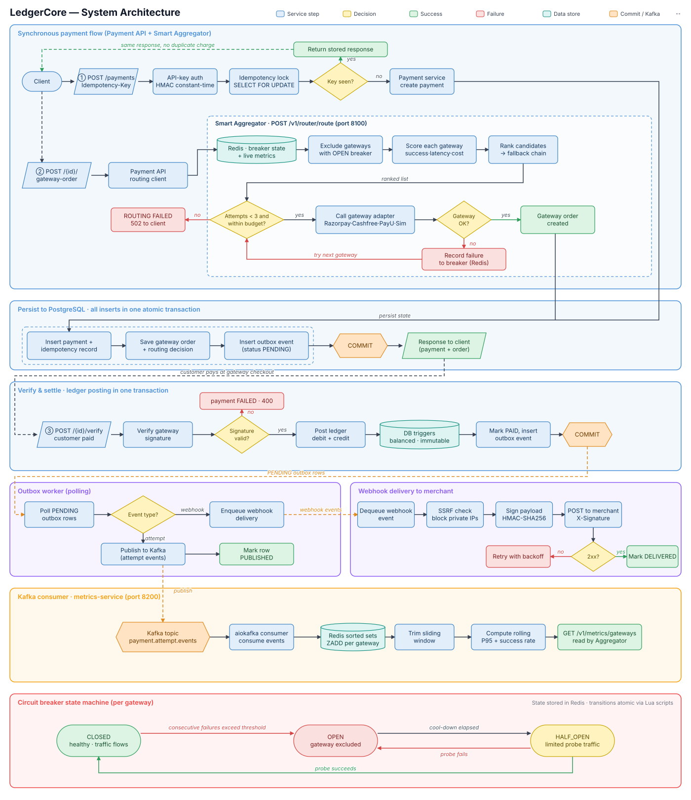

# LedgerCore — Distributed Payment Platform

LedgerCore is a distributed payment platform that creates and verifies payments, routes gateway orders through an intelligent aggregator, records balanced ledger entries, and processes payment events asynchronously.

It is built with **Python, FastAPI, PostgreSQL, Redis, Kafka, Next.js, and Docker Compose**.

## System architecture



The architecture diagram shows the synchronous payment flow, PostgreSQL transactions, gateway routing, payment verification, ledger posting, outbox processing, merchant webhooks, Kafka telemetry, Redis metrics, and circuit-breaker states.

### Services

| Component | Port | Responsibility |
|---|---:|---|
| Payment API | `8000` | Payment lifecycle, merchant authentication, idempotency, verification, ledger, and outbox |
| Smart Aggregator | `8100` | Gateway selection, scoring, circuit breakers, and failover |
| Metrics Service | `8200` | Consumes gateway-attempt events and maintains rolling gateway metrics |
| Frontend | `3000` | Merchant dashboard and checkout interface |
| Outbox Worker | — | Polls pending outbox events and publishes them for downstream processing |

### Main payment flow

1. The client creates a payment using the Payment API and an `Idempotency-Key`.
2. The API authenticates the merchant and checks the idempotency record.
3. For a new request, it creates a pending payment and stores the related records in PostgreSQL.
4. The gateway-order request is sent to the Smart Aggregator.
5. The Aggregator checks gateway health, scores eligible gateways, and attempts gateway order creation. It can fail over to another eligible gateway when an attempt fails.
6. The customer completes checkout with the selected gateway.
7. The Payment API verifies the gateway response before marking the payment as paid.
8. A successful payment is recorded in the double-entry ledger.
9. Outbox events are processed asynchronously for merchant webhook delivery and gateway telemetry.

## Core engineering features

### Intelligent gateway routing

The Smart Aggregator maintains a registry of gateway adapters, including Razorpay, Cashfree, PayU, and simulated gateways.

It ranks eligible gateways using the routing metrics and configuration available to the Aggregator. If a gateway attempt fails, the Aggregator can try the next eligible gateway, subject to its retry and latency-budget rules.

### Circuit breaker

Each gateway has its own Redis-backed circuit breaker:

- **CLOSED:** gateway is eligible for normal traffic.
- **OPEN:** gateway is temporarily excluded from routing.
- **HALF-OPEN:** a limited recovery probe is allowed.

Lua scripts are used for atomic state transitions and probe coordination across Aggregator instances.

### Idempotency and concurrency

Idempotency keys are scoped to a merchant and stored in PostgreSQL. The API uses database locking to coordinate concurrent requests using the same key.

**Validated:** 50 concurrent identical requests produced exactly one payment record and one ledger entry.

### Double-entry ledger

Every posted payment is represented by balanced debit and credit entries:

\[
\text{Total Debits} = \text{Total Credits}
\]

Database-level controls protect ledger consistency and prevent updates or deletions to existing ledger entries.

### Transactional outbox and background processing

Payment state changes and their outbox events are written in the same PostgreSQL transaction. The Outbox Worker polls pending events and processes them asynchronously.

The worker separates payment lifecycle events from gateway-attempt telemetry:

- Payment events are used to create merchant webhook deliveries.
- Gateway-attempt events are published to Kafka for metrics processing.

### Merchant webhooks

LedgerCore sends payment event notifications to configured merchant endpoints. Webhook payloads are signed using HMAC-SHA256. URL validation includes protection against requests to private and metadata IP addresses. Failed deliveries can be retried.

### Kafka and Redis metrics

The Outbox Worker publishes gateway-attempt events to Kafka. The Metrics Service consumes those events and stores recent gateway samples in Redis sorted sets.

The Aggregator reads the available metrics to inform later routing decisions. The documented metrics include rolling success-rate and P95-latency calculations.

## Technology stack

| Area | Technologies |
|---|---|
| Backend services | Python 3.12, FastAPI |
| Frontend | Next.js, React, TypeScript, Tailwind CSS |
| Database | PostgreSQL, SQLAlchemy, Alembic |
| Cache and distributed state | Redis |
| Event streaming | Apache Kafka, aiokafka |
| Gateway integration | Razorpay, Cashfree, PayU, simulated adapters |
| Infrastructure | Docker, Docker Compose |
| Testing and load testing | Pytest, Pytest-Asyncio, Grafana k6 |

## Project structure

```text
payment-api-backend/
├── app/                       # Payment API
│   ├── api/                   # Payment, merchant and webhook routes
│   ├── core/                  # Configuration, auth and database setup
│   ├── models/                # Payment, ledger and outbox models
│   ├── services/              # Payment, verification and webhook logic
│   └── workers/               # Outbox worker and event publishing
├── aggregator/                # Smart Aggregator
│   └── app/
│       ├── adapters/          # Gateway adapters
│       ├── main.py
│       ├── registry.py
│       ├── scoring.py
│       └── circuit_breaker.py
├── metrics_service/           # Gateway telemetry service
│   └── app/
│       ├── consumer.py
│       ├── redis_store.py
│       └── aggregator.py
├── frontend/                  # Next.js frontend
├── tests/                     # API and load tests
├── alembic/                   # Database migrations
├── schema.sql                 # Database schema and triggers
├── architecture.svg           # System architecture diagram
└── docker-compose.yaml        # Local multi-container setup
```

## Quickstart

### Prerequisites

- Docker Desktop with Docker Compose
- Python 3.12 (for running tests locally)
- Node.js (optional, for local frontend development)

### Configure environment

Copy the example environment file:

```bash
cp .env.example .env
```

Add the gateway credentials and other values required by your local setup. To generate the encryption key used for webhook secrets:

```bash
python -c "from cryptography.fernet import Fernet; print(Fernet.generate_key().decode())"
```

Set the generated value as `WEBHOOK_ENCRYPTION_KEY` in `.env`.

### Start the services

```bash
docker compose up -d --build
```

### Check service health

```bash
curl http://localhost:8000/ready
curl http://localhost:8100/health
curl http://localhost:8200/health
```

Open the frontend at `http://localhost:3000`.

## API overview

### Payment API — `http://localhost:8000`

| Method | Endpoint | Purpose |
|---|---|---|
| `POST` | `/api/v1/payments` | Create a payment |
| `POST` | `/api/v1/payments/{id}/gateway-order` | Request gateway order creation through the Aggregator |
| `POST` | `/api/v1/payments/{id}/verify` | Verify the gateway result and post ledger entries |
| `GET` | `/api/v1/payments` | List merchant payments |
| `GET` | `/ready` | Check API and PostgreSQL readiness |

### Smart Aggregator — `http://localhost:8100`

| Method | Endpoint | Purpose |
|---|---|---|
| `POST` | `/v1/router/route` | Score gateways and attempt gateway order creation |
| `POST` | `/v1/router/decision` | Return a routing decision without executing it |
| `GET` | `/health` | Check Aggregator health |

### Metrics Service — `http://localhost:8200`

| Method | Endpoint | Purpose |
|---|---|---|
| `GET` | `/v1/metrics/gateways` | Read available rolling gateway metrics |
| `GET` | `/health` | Check Metrics Service health |

## Testing

Run the test suites:

```bash
# Smart Aggregator
python -m pytest aggregator/tests

# Metrics Service
python -m pytest metrics_service/tests

# Payment API tests
python -m pytest tests
```

Build and lint the frontend:

```bash
cd frontend
npm run lint
npm run build
```

### Load test

```bash
k6 run tests/load/payment_load_test.js
```

**Recorded result:** 9.45 requests per second with 0% failed requests in the reported load-test run. This is the result of that test run, not a claim of maximum platform capacity.

The project test summary previously reported **97 passing tests**. Re-run the commands above for the current result.

## Configuration

The main environment variables include:

| Variable | Purpose |
|---|---|
| `RAZORPAY_KEY_ID`, `RAZORPAY_KEY_SECRET` | Razorpay credentials |
| `CASHFREE_CLIENT_ID`, `CASHFREE_CLIENT_SECRET` | Cashfree credentials |
| `PAYU_MERCHANT_KEY`, `PAYU_MERCHANT_SALT` | PayU credentials |
| `MERCHANT_API_KEY` | Merchant API authentication |
| `WEBHOOK_ENCRYPTION_KEY` | Encryption key for stored webhook secrets |

Use simulated gateways when provider credentials are not configured, where supported by the local environment.

## License

MIT
